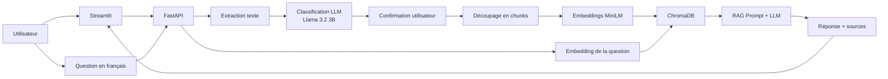

# Rapport — Assistant RAG avec Classification de Documents

## 1. Introduction
- Contexte du projet
- Objectifs : classification + RAG local
- Enjeu de souveraineté des données

## 2. Architecture Technique
- Schéma global (à insérer)
- Stack : Ollama + LangChain + ChromaDB + FastAPI + Streamlit
- Les 5 catégories de documents
- Workflow : Upload → Classification → Confirmation → Indexation → RAG

## 3. Corpus de Données
- Description des documents
- Répartition par catégorie
- Qualité de l'extraction

## 4. Module Classification

### 4.1 Approche choisie : Zero-Shot avec LLM local

Nous avons choisi une approche **zero-shot** pour la classification des documents.
Contrairement à un classifieur entraîné (type scikit-learn), cette approche ne
nécessite **aucune donnée d'entraînement**. Le LLM local (Llama 3.2 3B) utilise
sa compréhension générale du langage pour classer les documents dans les 5
catégories prédéfinies.

**Avantages :**
- Mise en place rapide (pas de phase d'entraînement)
- Fonctionne immédiatement sur de nouveaux types de documents
- Pas besoin de données étiquetées (coûteuses à produire)
- Exploite la compréhension sémantique du LLM

**Inconvénients :**
- Précision inférieure à un classifieur entraîné sur des données spécifiques
- Temps de classification plus long (~5-10s vs ~0.1s pour scikit-learn)
- Dépend de la qualité du prompt

### 4.2 Les 5 catégories

| # | Catégorie | Description | Exemples |
|---|-----------|-------------|----------|
| 1 | Règlements | Textes normatifs et contraignants | Lois, décrets, statuts, articles |
| 2 | Guides pratiques | Manuels et tutoriels | FAQ, guides d'utilisation, conseils |
| 3 | Procédures | Séquences d'actions | Démarches, workflows, étapes |
| 4 | Organisation & plannings | Structures et calendriers | Organigrammes, emplois du temps |
| 5 | Formulaires & documents ponctuels | Documents à remplir | Attestations, demandes, déclarations |

### 4.3 Prompt de classification

Le prompt est conçu pour :
1. Décrire précisément chaque catégorie avec des mots-clés distinctifs
2. Imposer un format de réponse JSON pour le parsing automatique
3. Demander un score de confiance pour gérer les cas ambigus
4. Contrainte de température basse (0.1) pour des réponses déterministes

### 4.4 Gestion de l'incertitude

Le système distingue 3 niveaux de confiance :
- **> 80%** : L'IA est confiante → proposition unique, confirmation simple
- **60-80%** : L'IA hésite → proposition + alternatives, choix guidé
- **< 60%** : L'IA ne sait pas → classification manuelle obligatoire

Dans tous les cas, **la confirmation de l'utilisateur est obligatoire** avant 
l'indexation du document.

## 5. Module RAG (Retrieval-Augmented Generation)

### 5.1 Architecture du pipeline

Le pipeline RAG suit le flux suivant :

1. **Question utilisateur** → texte libre en français (ou malgache)
2. **Filtre optionnel** → catégorie, fichier spécifique, ou aucun
3. **Embedding de la question** → vecteur de 384 dimensions (MiniLM)
4. **Recherche sémantique** → ChromaDB retourne les k chunks les plus proches
5. **Construction du prompt** → chunks + question + contraintes
6. **Génération** → Llama 3.2 produit la réponse
7. **Affichage** → réponse + sources + métadonnées

### 5.2 Filtres de recherche

Le système supporte 3 modes de recherche :
- **Général** : recherche dans tout le corpus (toutes catégories, tous fichiers)
- **Par catégorie** : limite la recherche à une des 5 catégories
- **Par fichier** : limite la recherche à un document spécifique

Les filtres sont implémentés au niveau de ChromaDB via la clause `where`, 
ce qui garantit que seuls les chunks correspondants sont retournés.

### 5.3 Prompt RAG

Le prompt impose des contraintes strictes au LLM :
- Répondre UNIQUEMENT en se basant sur le contexte fourni
- Dire "je ne trouve pas" si l'information est absente
- Ne jamais inventer d'information (anti-hallucination)
- Citer les sources utilisées
- Répondre en français

### 5.4 Modèle d'embedding

Nous utilisons `paraphrase-multilingual-MiniLM-L12-v2` :
- **Multilingue** : gère 50+ langues dont le français (et partiellement le malgache)
- **Léger** : ~470 Mo, rapide même sur CPU
- **Performance** : bon compromis qualité/vitesse pour un usage local

## 6. Architecture Technique

### 6.1 Vue d'ensemble

### 6.2 Stack technologique

| Composant | Technologie | Rôle |
|-----------|------------|------|
| LLM | Llama 3.2 3B (Ollama) | Génération de réponses + classification |
| Embeddings | MiniLM-L12-v2 (HuggingFace) | Vectorisation des textes |
| Base vectorielle | ChromaDB | Stockage et recherche sémantique |
| API | FastAPI | Interface REST entre frontend et backend |
| Interface | Streamlit | Interface utilisateur web |
| Langage | Python 3.11+ | Langage principal |
| OS | Windows 10/11 | Système d'exploitation |

### 6.3 Flux de données

**Upload + Classification :**
Utilisateur → Streamlit → API FastAPI → Extraction texte → 
Classifieur LLM → Proposition catégorie → Confirmation utilisateur → 
Découpage chunks → Embeddings → ChromaDB

**Questions-Réponses :**
Utilisateur → Streamlit → API FastAPI → Embedding question → 
ChromaDB (recherche + filtre) → Chunks pertinents → 
Prompt RAG → LLM → Réponse → Streamlit

### 6.4 Contraintes matérielles

| Ressource | Configuration actuelle | Recommandation production |
|-----------|----------------------|--------------------------|
| CPU | Intel i5-10300H | Intel i7 / AMD Ryzen 7 |
| RAM | 8 Go | 32 Go |
| GPU | GTX 1650 (4 Go) | RTX 4060 (8 Go+) |
| Stockage | 150 Go libres | SSD 500 Go |

### 6.5 Fonctionnement hors-ligne

Une fois les modèles téléchargés (Llama 3.2 + MiniLM), le système 
fonctionne **entièrement hors-ligne**. Aucune connexion internet 
n'est requise pour :
- La classification de documents
- La recherche sémantique
- La génération de réponses

C'est un avantage majeur pour la souveraineté des données et pour 
les zones à connectivité limitée.

## 7. Limites et Biais
- Limites techniques (à compléter)
- Biais du modèle (à compléter)
- Limites linguistiques (malgache)

## 8. Étude de Coût
- Configuration actuelle
- Configuration recommandée
- Comparaison local vs cloud

## 9. Conclusion
